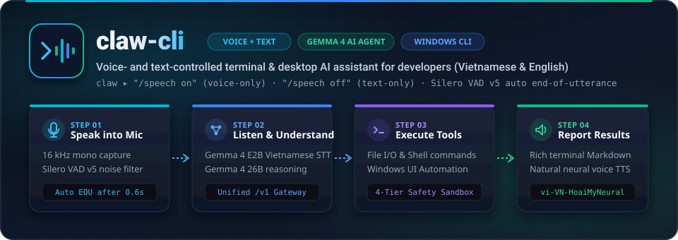
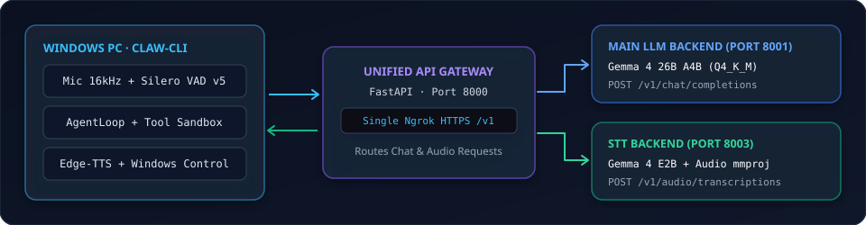

<div align="center">
  

  <br />

  <p>
    <a href="README.md"></a>
    <a href="README.vi.md"></a>
  </p>

  <p>
    <a href="https://github.com/vinh-gogo/claw-cli/actions"></a>
    
    
    
    
    
  </p>
</div>

---

## Architecture Overview

<div align="center">
  
</div>

### Key Highlights

- **Natural Vietnamese & Technical English Voice Control:** Speak naturally in Vietnamese mixed with developer terminology (`git`, `commit`, `docker`, `pytest`, `npm`...) to execute terminal tasks and control Windows desktop applications (`winctl`).
- **Automatic End-of-Utterance Detection (`Silero VAD v5 ONNX`):** Powered by **Silero VAD v5 ONNX** with adaptive noise-floor hysteresis to filter out fan/keyboard noise and **automatically finalize your spoken sentence after `0.6s` of silence**—no `Enter` key required.
- **Seamless Input Mode Switching:**
  - `Hybrid Mode (Default)`: Type commands directly or press `Space` on an empty prompt to speak.
  - `/speech on`: **Voice-only mode** (continuously listens for spoken commands turn after turn).
  - `/speech off`: **Text-only mode** (disables microphone trigger via `Space`).
- **Single-URL Unified Colab Gateway (`LLM + STT`):**
  - [`colab/colab_llama_cpp_ngrok.ipynb`](colab/colab_llama_cpp_ngrok.ipynb) boots in **~45 seconds** (using official pre-built `llama.cpp` Ubuntu CUDA binaries + parallel `hf_transfer` downloads) and serves both **Gemma 4 26B A4B** (`Port 8001`) and **Gemma 4 E2B STT + Audio mmproj** (`Port 8003`) behind a single **FastAPI Gateway (`Port 8000`)** and Ngrok `/v1` URL.
- **4-Tier Safety Sandbox (`Safety-First`):**
  - Classifies every action into `read`, `write`, `exec`, or `dangerous`.
  - Destructive commands (`rm -rf`, `sudo`, `git push --force`, `git reset --hard`...) **strictly require manual keyboard confirmation (`yes`)** and cannot be approved by voice.
  - Workspace path sandboxing prevents `../` traversal, protects sensitive files (`.env`, SSH keys), and scrubs secret environment variables (`KEY`, `SECRET`, `TOKEN`) before running shell subprocesses.

---

## Quick Start & Installation

### 1. Install on Windows

```powershell
# Clone repository
git clone https://github.com/vinh-gogo/claw-cli.git
cd claw-cli

# Create virtual environment and install dependencies with uv
uv venv --python 3.12
uv pip install -e ".[dev]"
```

### 2. Launch Unified Google Colab Server (~45 seconds)

Open [`colab/colab_llama_cpp_ngrok.ipynb`](colab/colab_llama_cpp_ngrok.ipynb) on Google Colab (L4 / A100 GPU):
1. **Cell 1 (~45s):** Downloads pre-built `llama-server` CUDA binaries + downloads all 3 GGUF files (`Gemma 4 26B` + `Gemma 4 E2B STT` + `mmproj`) in parallel at 500–800 MB/s.
2. **Cell 2:** Starts the `STT Backend` (`Port 8003`) and `Main LLM Backend` (`Port 8001`).
3. **Cell 3 & Cell 4:** Starts the `FastAPI Unified Gateway` (`Port 8000`) and publishes a single Ngrok URL (`https://.../v1`).

Configure `.env` in your project root:
```env
CLAW_BASE_URL=https://snowcapped-denice-unprudent.ngrok-free.dev/v1
CLAW_API_KEY=not-needed
```

---

## Usage Guide

### 1. Interactive Voice + Text REPL

```powershell
claw
```

| Command / Shortcut | Description |
| :--- | :--- |
| **`Space`** *(when prompt is empty)* | Start microphone capture (auto-completes utterance after `0.6s` silence or press `Enter`) |
| **`/speech on`** | Switch to **Voice-Only Mode** (continuous hands-free voice command loop) |
| **`/speech off`** | Switch to **Text-Only Mode** (disables `Space` microphone trigger) |
| **`/speech`** | Display current input mode status |
| **`Ctrl+T`** *(or say `"tắt tiếng"` / `"bật tiếng"`)* | Toggle neural TTS voice output (`vi-VN-HoaiMyNeural`) |
| **`Esc`** *(or say `"dừng"`)* | Cancel active turn immediately or exit voice listening |

### 2. One-Shot Execution

```powershell
claw ask "List all Python files in this directory and count total lines"
claw ask "Run pytest and summarize any failing tests" --yolo
```

### 3. Audio Devices & System Diagnostics

```powershell
# Full system health check (Mic, Speakers, Gemma 4 STT, Edge-TTS, Colab Server latency)
claw doctor

# List available input/output audio devices
claw devices

# List models exposed by the Colab Unified Gateway (/v1/models)
claw models
```

---

## Safety Policy Tiers

| Tier | Example Actions | Default Policy |
| :--- | :--- | :--- |
| `read` | `ls`, `cat`, `git status`, `grep`, `pytest --collect-only` | Auto-approved immediately |
| `write` | `write_file`, `edit_file`, writing files inside workspace | Displays diff & asks confirmation (voice or keyboard) |
| `exec` | `pytest`, `python main.py`, `npm install`, shell commands | Displays command & asks confirmation (voice or keyboard) |
| `dangerous` | `rm -rf`, `sudo`, `git push --force`, `dd`, `format` | **Keyboard-only confirmation (`yes`)**, voice approval forbidden |

---

## Standalone `gemma_stt` Package (Near-Real-Time Vietnamese ASR)

In addition to `claw`, this repository includes the standalone `gemma_stt` package supporting both local NVIDIA GPU execution (`local_gemma` with 4-bit/8-bit quantization) and remote OpenAI-compatible `/v1` inference (`remote_v1` / `auto`):

```powershell
# 1. Inspect GPU, CUDA, disk space, microphone, and Colab /v1 connectivity
python scripts/check_env.py

# 2. Record a 3-second microphone test clip or generate test fixtures
python scripts/record_test_wav.py --duration 3 --out outputs/test_mic.wav

# 3. Run near-real-time Vietnamese speech-to-text from microphone
python -m gemma_stt --config config.yaml

# 4. Run speech-to-text and forward recognized commands directly to Claw Agent
python -m gemma_stt --config config.yaml --forward-claw

# 5. Run latency (p50/p95, RTF) and WER/CER benchmark suite
python scripts/benchmark.py --config config.yaml
```

---

## Testing & Code Quality

```powershell
uv run pytest -v
uv run ruff check .
uv run mypy src
```

---

## License

Distributed under the [MIT License](LICENSE).
