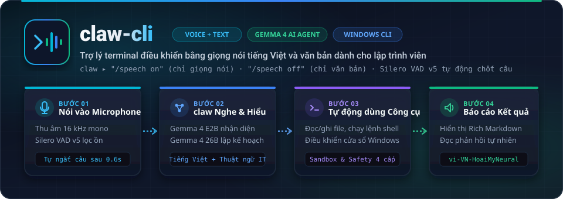

<div align="center">
  

  <br />

  <p>
    <a href="https://github.com/vinh-gogo/claw-cli/actions"></a>
    
    
    
    
    
  </p>
</div>

---

## Tổng quan kiến trúc

<div align="center">
  
</div>

### Điểm nổi bật

- **Điều khiển terminal & Windows bằng tiếng Việt tự nhiên:** Hỗ trợ nói tiếng Việt xen lẫn thuật ngữ kỹ thuật tiếng Anh (`git`, `commit`, `docker`, `pytest`, `npm`...) và điều khiển ứng dụng Windows (`winctl`).
- **Tự động phát hiện kết thúc câu nói (Automatic End-of-Utterance):** Tích hợp mạng nơ-ron **Silero VAD v5 ONNX** kết hợp ngưỡng năng lượng thích nghi (Adaptive Hysteresis) giúp lọc tiếng ồn quạt/bàn phím và **tự động chốt câu ngay khi bạn ngừng nói `0.6 giây`** mà không cần bấm `Enter`.
- **Chuyển đổi linh hoạt chế độ giọng nói & văn bản:**
  - `Hỗn hợp (Mặc định)`: Gõ lệnh trực tiếp hoặc nhấn `Space` khi dòng trống để nói.
  - `/speech on`: **Chỉ nhận lệnh bằng giọng nói** (tự động lắng nghe liên tục qua từng lượt).
  - `/speech off`: **Chỉ nhận lệnh bằng văn bản** (tắt kích hoạt thu âm bằng phím `Space`).
- **Một URL Ngrok duy nhất cho cả LLM & STT (`Unified FastAPI Gateway`):**
  - Notebook [`colab/colab_llama_cpp_ngrok.ipynb`](colab/colab_llama_cpp_ngrok.ipynb) khởi động trong **~45 giây** (sử dụng bản Pre-built CUDA binary của `llama.cpp` + tải song song qua `hf_transfer`), phục vụ đồng thời **Gemma 4 26B A4B** (`Port 8001`) và **Gemma 4 E2B STT + Audio mmproj** (`Port 8003`) phía sau **FastAPI Gateway (`Port 8000`)**.
- **Bảo mật & An toàn 4 cấp độ (`Safety-First`):**
  - Phân loại rủi ro: `read`, `write`, `exec`, `dangerous`.
  - Các lệnh nguy hiểm (`rm -rf`, `sudo`, `git push --force`, `git reset --hard`...) **bắt buộc xác nhận trực tiếp từ bàn phím** (`yes`), cấm duyệt bằng giọng nói.
  - Sandbox giới hạn đường dẫn trong thư mục làm việc hiện tại và tự động lọc sạch biến môi trường nhạy cảm (`KEY`, `SECRET`, `TOKEN`).

---

## Cài đặt & Khởi động nhanh

### 1. Cài đặt trên máy Windows

```powershell
# Clone repository
git clone https://github.com/vinh-gogo/claw-cli.git
cd claw-cli

# Tạo môi trường ảo và cài đặt với uv
uv venv --python 3.12
uv pip install -e ".[dev]"
```

### 2. Khởi chạy Google Colab Server (~45 giây)

Mở [`colab/colab_llama_cpp_ngrok.ipynb`](colab/colab_llama_cpp_ngrok.ipynb) trên Google Colab (GPU L4 / A100):
1. **Ô 1 (~45s):** Tải Pre-built `llama-server` CUDA binary + tải song song 3 file GGUF (`Gemma 4 26B` + `Gemma 4 E2B STT` + `mmproj`) với tốc độ 500–800 MB/s.
2. **Ô 2:** Khởi động `STT Backend` (Port `8003`) và `Main LLM Backend` (Port `8001`).
3. **Ô 3 & Ô 4:** Khởi động `FastAPI Gateway` (Port `8000`) và xuất bản một URL Ngrok duy nhất (`https://.../v1`).

Cấu hình `.env` tại thư mục dự án:
```env
CLAW_BASE_URL=https://snowcapped-denice-unprudent.ngrok-free.dev/v1
CLAW_API_KEY=not-needed
```

---

## Hướng dẫn sử dụng

### 1. Phiên tương tác đầy đủ (Interactive Voice + Text REPL)

```powershell
claw
```

| Lệnh / Phím tắt | Chức năng |
| :--- | :--- |
| **`Space`** *(khi dòng trống)* | Bật microphone để nói (tự động chốt câu khi ngừng nói `0.6s` hoặc nhấn `Enter`) |
| **`/speech on`** | Chuyển sang chế độ **chỉ nhận lệnh bằng giọng nói** (lắng nghe liên tục từng câu) |
| **`/speech off`** | Chuyển sang chế độ **chỉ nhận lệnh bằng văn bản** (tắt kích hoạt mic bằng `Space`) |
| **`/speech`** | Xem trạng thái chế độ đầu vào hiện tại |
| **`Ctrl+T`** *(hoặc nói `"tắt tiếng"` / `"bật tiếng"`)* | Bật / tắt đọc phản hồi bằng giọng nói TTS (`vi-VN-HoaiMyNeural`) |
| **`Esc`** *(hoặc nói `"dừng"`)* | Huỷ ngay thao tác đang chạy hoặc thoát chế độ nghe |

### 2. Thực thi một lệnh duy nhất (One-shot)

```powershell
claw ask "Liệt kê các file python trong thư mục này rồi đếm tổng số dòng"
claw ask "Chạy test và cho tôi biết bài nào bị lỗi" --yolo
```

### 3. Kiểm tra thiết bị & Chẩn đoán hệ thống

```powershell
# Chẩn đoán toàn diện (Mic, Loa, Gemma 4 STT, Edge-TTS, kết nối Colab Server)
claw doctor

# Liệt kê danh sách microphone và loa
claw devices

# Xem danh sách model trên Colab Gateway (/v1/models)
claw models
```

---

## Bảng phân loại rủi ro an toàn

| Cấp độ | Hành động ví dụ | Hành vi mặc định |
| :--- | :--- | :--- |
| `read` | `ls`, `cat`, `git status`, `grep`, `pytest --collect-only` | Tự động duyệt chạy ngay |
| `write` | `write_file`, `edit_file`, ghi file trong workdir | Hiển thị diff, hỏi xác nhận (cho phép duyệt bằng giọng nói) |
| `exec` | `pytest`, `python main.py`, `npm install`, lệnh shell | Hiển thị lệnh, hỏi xác nhận (cho phép duyệt bằng giọng nói) |
| `dangerous` | `rm -rf`, `sudo`, `git push --force`, `dd`, `format` | **Chỉ cho phép gõ tay `yes` trên bàn phím**, cấm duyệt bằng giọng |

---

## Package độc lập `gemma_stt` (Nhận dạng giọng nói tiếng Việt gần Realtime)

Ngoài tích hợp trực tiếp trong `claw`, dự án còn cung cấp package `gemma_stt` hỗ trợ cả chạy cục bộ (`local_gemma` trên GPU NVIDIA Windows với lượng tử hóa 4-bit/8-bit) lẫn qua Colab Gateway (`remote_v1` / `auto`):

```powershell
# 1. Kiểm tra môi trường GPU, CUDA, dung lượng đĩa và kết nối Colab /v1
python scripts/check_env.py

# 2. Thu âm thử 3 giây từ microphone hoặc sinh bộ WAV kiểm thử
python scripts/record_test_wav.py --duration 3 --out outputs/test_mic.wav

# 3. Chạy nhận dạng giọng nói tiếng Việt gần realtime từ microphone
python -m gemma_stt --config config.yaml

# 4. Chạy nhận dạng kèm chuyển tiếp lệnh sang Claw Agent
python -m gemma_stt --config config.yaml --forward-claw

# 5. Chạy benchmark độ trễ (p50/p95, RTF) và WER/CER
python scripts/benchmark.py --config config.yaml
```

---

## Kiểm thử & Chất lượng mã nguồn

```powershell
uv run pytest -v
uv run ruff check .
uv run mypy src
```

---

## Giấy phép

Dự án được phân phối dưới giấy phép [MIT](LICENSE).
