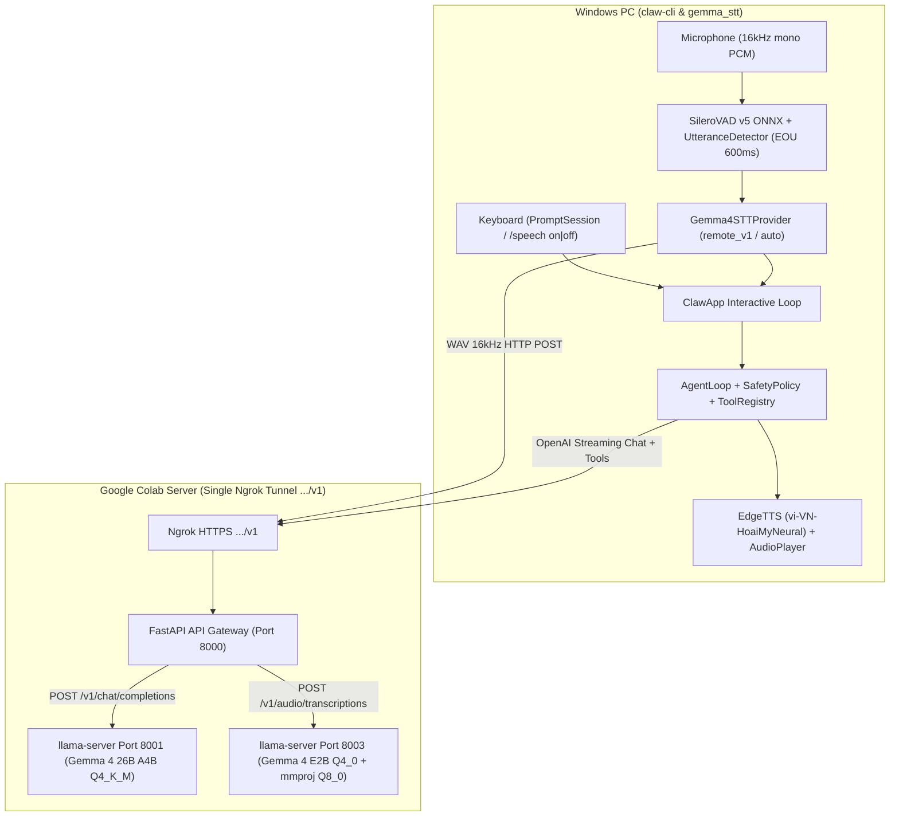

# System Patterns — Kiến trúc & Mẫu thiết kế hệ thống

## 1. Kiến trúc tổng thể (End-to-End Architecture)

## 2. Các quyết định kỹ thuật quan trọng (Key Technical Decisions)

### 2.1. Unified FastAPI Gateway trên Google Colab (`colab/colab_llama_cpp_ngrok.ipynb`)
- **Một URL Ngrok duy nhất (`Port 8000`):**
  - `GET /v1/models`: Trả về danh sách 4 model ID (`gemma-4-26B-A4B-it-Q4_K_M.gguf`, `main-llm`, `gemma-4-stt`, `google/gemma-4-E2B-it`). Đặt LLM 26B ở vị trí đầu tiên để client `model="auto"` luôn chọn đúng LLM chat chính.
  - `POST /v1/audio/transcriptions`: Nhận file âm thanh (`WAV`/`MP3`/v.v.), chuẩn hóa về `16kHz mono 16-bit PCM WAV`, kiểm tra năng lượng RMS (`rms < 1e-4` trả rỗng ngay để chống hallucination khi im lặng), mã hóa base64 `input_audio` kèm prompt phiên âm tiếng Việt và chuyển tiếp tới `llama-server` Port `8003` (`Gemma 4 E2B + mmproj`).
  - `POST /v1/chat/completions`: Tự động định tuyến tới Port `8003` nếu `model` thuộc nhóm STT hoặc payload có `input_audio`, ngược lại stream trực tiếp tới Port `8001` (`Gemma 4 26B`).
- **Thứ tự nạp VRAM trên Colab:**
  - Khởi động **STT Backend (Port 8003, ~3.3 GB VRAM)** trước với `-ngl 99` để Audio Encoder (`mmproj`) + E2B nằm 100% trên GPU.
  - Khởi động **Main LLM Backend (Port 8001, ~16.8 GB VRAM)** sau với `--fit on --fit-target 512` để `llama-server` tự động cân đối KV cache vừa khít dung lượng VRAM còn lại trên GPU L4 24GB.

### 2.2. Phát hiện kết thúc câu tự động (Silero VAD v5 ONNX + Adaptive Hysteresis)
- **Tương thích Silero VAD v5 & v4 (`src/claw/voice/vad.py` và `src/gemma_stt/vad.py`):**
  - Tự động kiểm tra tên input của model ONNX (`state` cho Silero v5 với tensor `(2, 1, 128)` + `context` `(1, 64)` ghép trước frame `512` mẫu thành `(1, 576)`; hoặc `h, c` `(2, 1, 64)` cho Silero v4).
- **Thuật toán End-of-Utterance (`UtteranceDetector`):**
  - Giữ `pre_roll_ms = 300ms` để không mất âm đầu câu.
  - Khi `prob >= threshold (0.5)`: bắt đầu thu câu nói (`in_speech = True`).
  - Sử dụng **Hysteresis** (`end_threshold = 0.35`) kết hợp theo dõi `peak_rms` và `_noise_rms`. Khi người nói dừng lại quá `silence_ms = 600ms` (hoặc nhấn `Enter`), câu nói được chốt ngay lập tức.

### 2.3. Chế độ điều khiển `/speech on` & `/speech off` (`src/claw/app.py`, `src/claw/ui/prompt.py`, `src/claw/agent/router.py`)
- `UIStatus.speech_mode` có 3 trạng thái:
  - `"hybrid"` (mặc định khi mới mở): Gõ văn bản hoặc nhấn `Space` ở dòng trống để bật mic ngay lập tức (`event.app.exit(result="")`).
  - `"on"` (`/speech on`): Chỉ nhận lệnh bằng giọng nói. Vòng lặp tự động gọi `record_voice_input()` liên tục. Hỗ trợ thoát về `/speech off` bằng giọng nói (`"tắt giọng nói"`, `"speech off"`), phím `Esc`, hoặc phím `/` để nhập lệnh.
  - `"off"` (`/speech off`): Chỉ nhận lệnh bằng văn bản. Phím `Space` ở đầu dòng chỉ chèn khoảng trắng bình thường, không bật mic.
